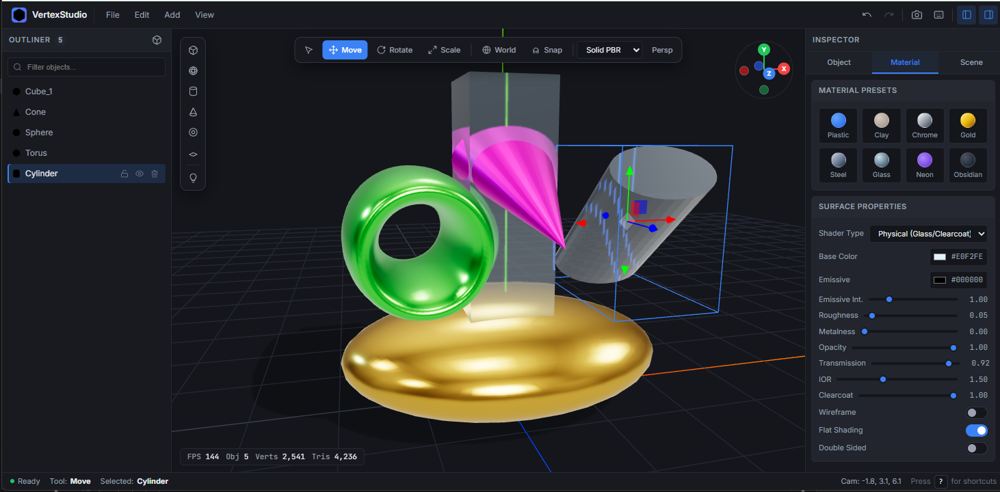
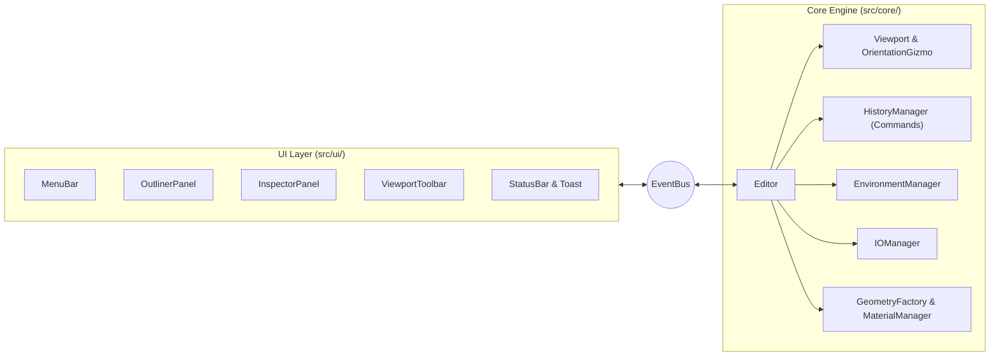

# VertexStudio — Browser-Based 3D Scene Editor

[](https://threejs.org/)
[](https://developer.mozilla.org/en-US/docs/Web/JavaScript/Guide/Modules)
[](#architecture)
[](LICENSE)

**VertexStudio** is a lightweight, zero-build, studio-grade 3D scene editor built with **Three.js** and **Vanilla ES Modules**. Designed with a Blender/Spline-inspired dark interface, it features a decoupled event-driven engine, command-pattern Undo/Redo history, physically based rendering (PBR), drag-and-drop multi-format 3D asset import/export, and an interactive viewport gizmo.



> **Live Demo:** _Enable GitHub Pages in repository settings (workflow included in `.github/workflows/pages.yml`) and update this link: `https://<your-username>.github.io/<repo-name>/`_

<!--
Optional: Add a screenshot or short GIF of the editor once deployed:

-->

---

## Engineering Highlights

This project demonstrates production-oriented frontend and WebGL engineering practices without relying on heavy frameworks or bundlers:

- **Decoupled Event-Driven Architecture**: A typed pub/sub [`EventBus`](src/core/EventBus.js) cleanly separates the Three.js scene/render loop from all UI panels (`MenuBar`, `OutlinerPanel`, `InspectorPanel`, `ViewportToolbar`, `StatusBar`).
- **Command Pattern Undo/Redo**: [`HistoryManager`](src/core/HistoryManager.js) implements reversible commands (`AddObjectCommand`, `RemoveObjectCommand`, `TransformCommand`, `RenameObjectCommand`, `ToggleVisibilityCommand`, `ReplaceMaterialCommand`) supporting up to 100 history states across both gizmo drags and inspector edits.
- **Physically Based Rendering (PBR) Pipeline**: Configured with `ACESFilmicToneMapping`, `PCFSoftShadowMap`, `SRGBColorSpace`, built-in `RoomEnvironment` IBL (for realistic reflections out of the box), PolyHaven HDRI presets, and local `.hdr` file support.
- **Zero-Build Native ES Modules**: Uses browser-native `<script type="importmap">` to load Three.js modules directly, enabling instant startup and effortless static deployment.
- **Thoughtful 3D UX Details**:
  - **Drag-threshold raycasting** prevents orbiting gestures from accidentally selecting or deselecting objects.
  - **Scrubbable X/Y/Z numeric inputs** allow horizontal mouse-dragging on axis badges (just like Blender/Unity) with rotation edited in human-friendly degrees.
  - **Clean exports** serialize only user-created scene objects, stripping editor helpers, grids, and transform gizmos.

---

## Features

### 3D Modeling & Scene Management

- **13 Grounded Primitives**: Cube, Sphere, Cylinder, Cone, Plane, Torus, Torus Knot, Capsule, Tetrahedron, Octahedron, Dodecahedron, Icosahedron, and Extruded Star.
- **Dynamic Scene Lights**: Add Point, Spot, and Directional lights with live visual helpers and dedicated light controls (color, intensity, distance, cone angle, penumbra, shadows).
- **Scene Outliner**: Real-time search filter, object type icons, double-click inline renaming, visibility toggles, and object locking (prevents accidental selection/transforms).

### Viewport & Camera Controls

- **Transform Gizmos**: Move (`G`/`W`), Rotate (`R`/`E`), Scale (`S`), and Select-Only (`Q`) modes with **World / Local** coordinate space switching (`L`) and configurable grid snapping.
- **Interactive 3D Orientation Gizmo**: Clickable `X / -X / Y / -Y / Z / -Z` compass in the viewport corner for smooth animated camera alignment.
- **Camera System**: Toggle between **Perspective** and **Orthographic** projections (`P`), focus on selection (`F`), and jump to Front / Right / Top / Isometric presets (`1 / 3 / 7 / 0`).
- **Viewport Shading Modes**: Switch between **Solid PBR**, **Clay**, **Wireframe**, and **Normals** visualization.
- **Live Telemetry**: Real-time FPS counter, object count, vertex count, triangle count, and camera coordinates.

### Materials & Environment

- **8 One-Click PBR Presets**: Plastic, Clay, Chrome, Gold, Brushed Steel, Glass (transmission + IOR + clearcoat), Neon (emissive), and Obsidian.
- **Full Material Inspector**: Switch shader types (`MeshStandardMaterial`, `MeshPhysicalMaterial`, `MeshPhongMaterial`, `MeshLambertMaterial`, `MeshBasicMaterial`) and fine-tune color, emissive, roughness, metalness, opacity, transmission, IOR, clearcoat, wireframe, flat shading, and double-sided rendering.
- **Lighting & Atmosphere**: Adjustable key/ambient studio lights, IBL intensity, exposure, HDRI skybox toggle, and exponential fog.

### Import, Export & Persistence

- **Drag-and-Drop Import**: Drop `.glb`, `.gltf`, `.obj`, `.stl`, `.hdr`, or `.json` project files directly onto the viewport (imported models are automatically normalized and grounded on `Y = 0`).
- **Multi-Format Export**: Export scenes as binary `.glb`, JSON `.gltf`, Wavefront `.obj`, binary `.stl`, native `.3d.json` project files, or clean `.png` screenshots.

---

## Architecture



### Project Structure

```text
.
├── index.html                    # Semantic studio layout shell & Three.js importmap
├── styles/
│   ├── tokens.css                # Design system tokens (colors, typography, radii, z-index)
│   ├── layout.css                # CSS Grid workspace shell & collapsible panels
│   └── components.css            # Inputs, scrubbable Vec3 controls, modals, toasts
├── src/
│   ├── main.js                   # Application bootstrap, file inputs & drag-and-drop wiring
│   ├── core/
│   │   ├── EventBus.js           # Pub/sub event hub
│   │   ├── Editor.js             # Central state, object lifecycle & scene metrics
│   │   ├── Viewport.js           # Renderer, cameras, Orbit/TransformControls, raycasting
│   │   ├── OrientationGizmo.js   # Interactive 3D axis compass
│   │   ├── HistoryManager.js     # Command-pattern Undo/Redo stack
│   │   ├── GeometryFactory.js    # Mesh primitives & scene light factory
│   │   ├── MaterialManager.js    # PBR shader switcher & material presets
│   │   ├── EnvironmentManager.js # Studio lighting, RoomEnvironment IBL, HDRI & fog
│   │   ├── IOManager.js          # GLB/GLTF/OBJ/STL/JSON/PNG import & export
│   │   └── KeyboardShortcuts.js  # Global shortcut bindings
│   └── ui/
│       ├── MenuBar.js            # Top dropdown menus & quick actions
│       ├── ViewportToolbar.js    # Floating viewport HUD & quick-add rail
│       ├── OutlinerPanel.js      # Searchable scene hierarchy & inline rename
│       ├── InspectorPanel.js     # Tabbed Object / Material / Scene inspector
│       ├── StatusBar.js          # Bottom status bar & live FPS/geometry telemetry
│       ├── Toast.js              # Non-blocking notification stack
│       └── icons.js              # Inline SVG icon set
├── .github/workflows/pages.yml   # Automated GitHub Pages deployment workflow
├── CHANGELOG.md                  # Version history & refactoring log
├── CONTRIBUTING.md               # Contribution & code style guidelines
└── LICENSE                       # MIT License
```

---

## Keyboard Shortcuts

| Action                    | Shortcut              | Action                  | Shortcut                    |
| :------------------------ | :-------------------- | :---------------------- | :-------------------------- |
| Select Mode               | `Q`                   | Undo / Redo             | `Ctrl+Z` / `Ctrl+Y`         |
| Move Gizmo                | `G` or `W`            | Duplicate Selected      | `Shift+D`                   |
| Rotate Gizmo              | `R` or `E`            | Delete Selected         | `Del` / `Backspace` / `X`   |
| Scale Gizmo               | `S`                   | Focus on Selected       | `F`                         |
| World / Local Space       | `L`                   | Toggle Visibility       | `H`                         |
| Perspective / Ortho       | `P`                   | Reset Pos / Rot / Scale | `Alt+G` / `Alt+R` / `Alt+S` |
| Front / Right / Top / Iso | `1` / `3` / `7` / `0` | Save Project (`.json`)  | `Ctrl+S`                    |
| Toggle Left / Right Panel | `[` / `]`             | Shortcuts Reference     | `?`                         |

---

## Getting Started

Because the application uses native browser ES Modules (`<script type="module">`), serve the directory over a local HTTP server (opening `index.html` directly via `file://` is blocked by browser CORS policies).

### Option 1 — Python (No dependencies)

```bash
python -m http.server 8000
```

Open `http://localhost:8000` in your browser.

### Option 2 — Node.js (`npx`)

```bash
npx serve .
```

### Option 3 — VS Code

Install the **Live Server** extension, right-click `index.html`, and select **Open with Live Server**.

### Deploying to GitHub Pages

A GitHub Actions workflow is already configured at [`.github/workflows/pages.yml`](.github/workflows/pages.yml). Push to `main` and enable **Settings → Pages → Source: GitHub Actions** to publish a live demo automatically.

---

## Roadmap

- [ ] Multi-object selection & parent/child grouping in the Outliner
- [ ] Texture map uploads (Albedo, Normal, Roughness, Metalness)
- [ ] LocalStorage auto-save & session recovery
- [ ] Post-processing pipeline (Selective Bloom & SSAO)

---

## License

This project is licensed under the **MIT License** — see [LICENSE](LICENSE) for details.
